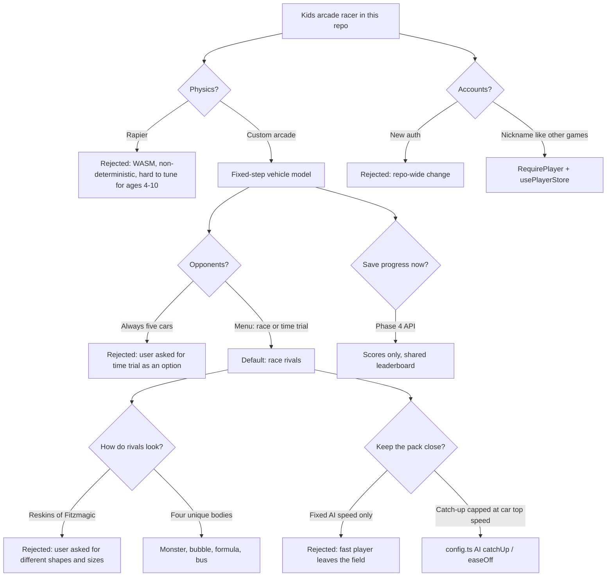

# Racing — decisions

Newest first. Each entry is a choice that later work should not silently reverse. If you reverse one, add a new entry that says so.

## Decision tree (how we got here)

## Log

### 2026-10-25 — Phase 3 rivals

| ID | Decision | Why | Rejected |
| --- | --- | --- | --- |
| R-20 | Menu offers **Race rivals** (default) and **Time trial** | User asked for a time-trial option before the race so competition is optional | Always-on five-car races; hiding rivals behind a locked tile |
| R-21 | Four unique bodies, not Fitzmagic reskins | User asked for different shapes and sizes | Palette-swaps of the player car |
| R-22 | Rivals: Bertha (truck), Zippy (bubble), Rita (formula), Bus-ter (bus) | Read as different from across the grid; each has its own radius and handling | Identical hitboxes |
| R-23 | Player starts at the **back** of the grid | There is always someone to chase | Pole by default (`playerSlot: 0` still exists for tests) |
| R-24 | Light pack-keeping: behind → faster (capped at that car's top speed) and better corners; ahead → ease off | Otherwise a gas-only child gaps the field by hundreds of metres on desert | Pure fixed AI speed (the original "no rubber-band" line in `difficulty.ts`); uncapped catch-up |
| R-25 | Player car is heavier the more assist they have | A bump must not ruin a little one's race | Equal mass for all cars |
| R-26 | Rivals never pick up coins/gems | Pickups are the player's toy; AI collecting them would steal the HUD | Shared pickups |
| R-27 | Seeded AI (`track.seed:name`) | Races replay; tests are deterministic | `Math.random()` |
| R-28 | Sounds and camera kicks only for the **player's** events | Four rival walls would drown the mix | SFX per racer |
| R-29 | Scoring unchanged (time + coins + gems) | One leaderboard for both modes; place is flavour | Separate race vs time-trial scores |
| R-30 | Results list every car; unfinished cars say "still racing" | Player finish is the moment; we do not wait for the AI | Block the card until all five finish |
| R-31 | Grid rank uses road position when fractions are equal | Otherwise everyone on the grid showed as 1st | `fraction` only (0 for every car behind the line) |

### Earlier (Phases 1–2, from the original architecture doc)

| ID | Decision | Why | Rejected |
| --- | --- | --- | --- |
| R-01 | No Rapier; custom arcade vehicle | Deterministic, tunable for children, matches claw/frogger | Rigid-body WASM |
| R-02 | Nickname identity, no accounts | Repo-wide; family game | Inventing auth |
| R-03 | Feature lives in `src/features/racing/` | Same shape as claw/frogger | `games/the-fitz-and-furious/` |
| R-04 | Engine is pure TS; renderer only reads it | Testable; no React/three in the sim | Driving the sim from R3F |
| R-05 | Zustand for HUD snapshots only | Avoid per-frame React renders | Putting vehicle state in zustand |
| R-06 | Deliver in numbered phases | Scope is larger than one change | Building persistence and garage first |
| R-07 | Client simulates the race; server will only bound results (Phase 4) | Same honesty model as Frogger/claw | Authoritative server physics |
| R-08 | Coins/gems counted in Phase 2, not saved | Needed to finish a lap fantasy; persistence is Phase 4 | Skipping pickups until the API |
| R-09 | Assist is a player setting, separate from track tier | A four-year-old and an older sibling can share a track | Tying help to the world |
| R-10 | All five tracks open from launch | Show range up front; unlocks stay Phase 4/6 | Gating worlds behind wins |
| R-11 | Worlds are data (`WorldProfile` + `WorldTheme` + props builder) | Adding a track should not fork the renderer | One-off scenes |
| R-12 | Road is flat apart from ramps and explicit hills | Kids must be able to drive it; no cliff walls | Full 3D mesh collision |
| R-13 | Fitzmagic lofted hypercar replaces the jeep | Visual identity; same `VehicleVisual` contract | Shipping the cartoon buggy |
| R-14 | Crossing animals are a state machine in the engine, roamers are render-only | Hits must be fair and testable | Decorative-only animals on the road |
| R-15 | `RaceManager` always ranked N cars; Phase 2 raced 1 | Avoid rewriting ranking for Phase 3 | A solo-only progress tracker |
